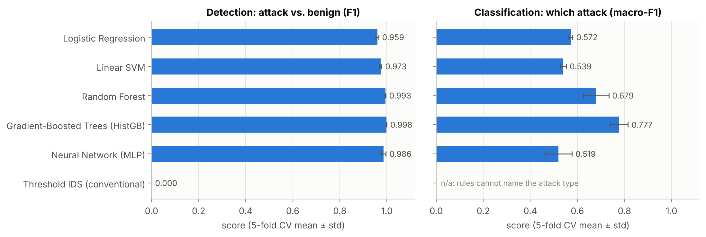

# AI-Assisted Web Application Penetration Testing

**Detecting and classifying web attacks in CIC-IDS2017 network flows with machine learning, compared with conventional detection.**

> **Research question:** *How effectively can AI/ML assist in detecting and classifying web-application attacks, and how does its performance compare with conventional detection?*
> Course project, CSCI561 Computer and Network Security. The full write-up is in [`paper/`](paper/).

This repository contains a reproducible pipeline that downloads and verifies the **CIC-IDS2017** web-attack data (brute force, XSS, SQL injection), trains **five AI/ML detectors**, and compares them with a **conventional statistical-threshold IDS**. It then stress-tests every model with five robustness and validity experiments, and includes an **OWASP ZAP lab harness** for testing the prototype against an intentionally vulnerable web app.

---

## Key findings

| | Detection F1 (5-fold CV) | Attack-type macro-F1 (CV) | F1 on real attack requests, no fingerprint (S3) |
|---|---|---|---|
| Logistic Regression | 0.959 | 0.572 | 0.741 |
| Linear SVM | 0.973 | 0.539 | 0.810 |
| Random Forest | 0.993 | 0.680 | **0.968** |
| Gradient-Boosted Trees | **0.998** | **0.777** | 0.947 |
| Neural Network (MLP) | 0.986 | 0.520 | 0.909 |
| Threshold IDS (conventional) | 0.000 | n/a | 0.000 |

- **AI detects what per-metric rules cannot.** The attack flows are statistically ordinary: on every metric they sit near the benign median. The conventional threshold IDS therefore catches **none** of them at a 1% false-alarm budget (ROC-AUC 0.49), while the ML detectors reach F1 0.95–0.998.
- **Naming the attack is harder than detecting it** (macro-F1 ≤ 0.78), mainly because brute force and XSS get confused with each other.
- **A validity audit explains why, and corrects the headline.** **91%** of the flows labelled as attacks carry **no payload** (TCP connection fragments), and **94%** share the attacker's TCP initial window, which fingerprints the host rather than the attack. With both controlled, the best detector still reaches **F1 0.968**, and attack-type macro-F1 **rises to 0.90**.
- **Robustness limits.** An attack type never seen in training (SQLi) is missed far more often (Random Forest 0.95 → 0.43). Slowing an attack down **2×** collapses the Random Forest (0.99 → 0.10), while the linear models stay at ≥ 0.94 even at 100×. On an unseen benign day, false alarms more than double for the linear models (2.4%), while the tree ensembles stay at ≤ 0.13%.

<p align="center">
  <br>
  
</p>

---

## Repository layout

```
├── src/
│   ├── download_data.py     download (official source -> pinned mirror), verify, preprocess
│   ├── preprocess.py        cleaning, de-duplication, HTTP-flow scope
│   ├── config.py · data.py · metrics.py
│   ├── models.py            5 AI/ML detectors (LogReg, Linear SVM, Random Forest, HistGB, MLP)
│   ├── baseline.py          conventional statistical-threshold IDS (Denning-style)
│   ├── train_eval.py        E1 detection + E2 attack-type classification (held-out + 5-fold CV)
│   ├── unseen_attacks.py    E3 attack types never seen in training
│   ├── evasion_timing.py    E4 low-and-slow timing evasion
│   ├── cross_day.py         E5 false alarms on an unseen benign day
│   ├── scope_shortcut.py    E6 effect of the evaluation scope (port shortcut)
│   ├── validity_audit.py    E7 payload-less artifacts & TCP-fingerprint shortcut
│   ├── make_figures.py      all paper figures
│   ├── run_all.py           runs everything in order
│   └── lab_harness/         OWASP ZAP + Juice Shop practical comparison (see its README)
├── results/                 metrics JSON, CSV tables, figures (committed)
├── paper/                   scientific paper (.docx, .pdf) + its generator
├── notebooks/walkthrough.ipynb
├── tests/                   flow-column mapping tests
└── requirements.txt
```

## Quick start

```bash
git clone https://github.com/y0usSs3F/AI-Assisted-Web-Application-Penetration-Testing.git
cd AI-Assisted-Web-Application-Penetration-Testing
python -m pip install -r requirements.txt

cd src
python download_data.py          # ~136-224 MB download, verified against published counts
python run_all.py --skip-download  # all experiments + figures (~15-20 min on a laptop)
```

Everything is seeded (`RANDOM_STATE = 42`), so the numbers in `results/` and in the paper are reproduced exactly.

## Data

[CIC-IDS2017](https://www.unb.ca/cic/datasets/ids-2017.html) (Canadian Institute for Cybersecurity), "MachineLearningCVE" CSV release:

| File | Use |
|---|---|
| `Thursday-WorkingHours-Morning-WebAttacks.pcap_ISCX.csv` | web attacks + benign traffic (main dataset) |
| `Monday-WorkingHours.pcap_ISCX.csv` | 100% benign day, used to measure false alarms on unseen data |

**`download_data.py`** first tries the official archive, then a public GitHub mirror that it fetches with a blob-less partial clone **pinned to a commit**, so only ~136 MB is transferred. If both fail, it prints manual instructions. Every file is **verified** against the published label counts (Thursday 170,366 flows = 168,186 benign / 1,507 brute force / 652 XSS / 21 SQLi; Monday 529,918 benign), and its SHA-256 is checked.

**Cleaning:** repair mis-encoded labels → drop a duplicated column → drop 135 zero-duration flows with undefined rates (all benign) → drop 6,052 exact duplicates → drop 10 constant columns → **keep HTTP (port-80) flows only**, because every attack targets port 80 and keeping other ports lets a model "detect" web traffic instead of attacks (experiment E6). Result: **19,725 flows, 66 features** (17,582 benign · 1,470 brute force · 652 XSS · 21 SQLi), plus 47,799 benign Monday HTTP flows.

## Models and baseline

| Detector | Notes |
|---|---|
| Logistic Regression, Linear SVM | signed-log + standardised features, class-balanced |
| Random Forest (300 trees) | class-balanced |
| Gradient-Boosted Trees | scikit-learn `HistGradientBoostingClassifier` (XGBoost family; XGBoost is a drop-in swap) |
| Neural Network (MLP 128-64) | signed-log + standardised, balanced sample weights, early stopping |
| **Threshold IDS (conventional)** | learns each metric's benign range (0.5–99.5th pct.); alarm when ≥ m metrics are out of range, with m tuned to a 1% false-alarm budget. It needs no attack labels and every alarm can be explained. |

Signature-based scanners and WAFs match **payloads**, which the flow dataset doesn't contain. That comparison is done live with the OWASP ZAP harness instead.

## Practical lab: AI prototype vs. OWASP ZAP

[`src/lab_harness/`](src/lab_harness/README_LAB.md) runs the practical component in an **authorised, isolated lab**:
benign browsing of OWASP Juice Shop is captured, then an OWASP ZAP full active scan is captured. Both captures go through CICFlowMeter, every detector scores the flows, and a Markdown report compares ZAP's confirmed vulnerabilities with the AI's detection rate and false-alarm rate. `flow_columns.py` maps both CICFlowMeter implementations (Java v4, Python port) onto the training feature names and converts the Python port's seconds to microseconds. `tests/` checks the mapping against the tools' real column names.

## Responsible use

This project uses only public data. The lab harness launches an intentionally vulnerable application and attacks it. Run it only on systems you own or are authorised to test.

## Citation

If you use CIC-IDS2017, cite: I. Sharafaldin, A. H. Lashkari, A. A. Ghorbani, "Toward Generating a New Intrusion Detection Dataset and Intrusion Traffic Characterization," ICISSP 2018. The validity audit builds on G. Engelen, V. Rimmer, W. Joosen, "Troubleshooting an Intrusion Detection Dataset: the CICIDS2017 Case Study," IEEE SPW 2021.
