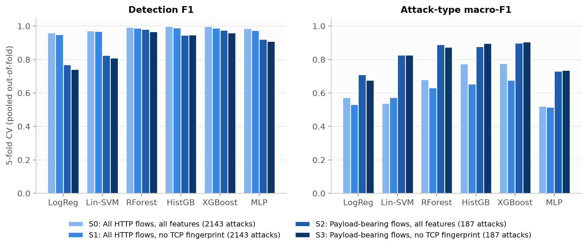
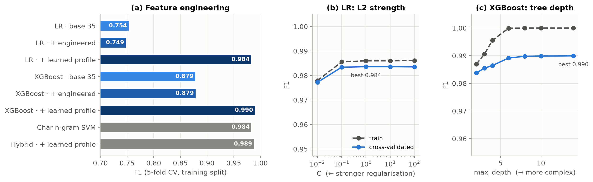
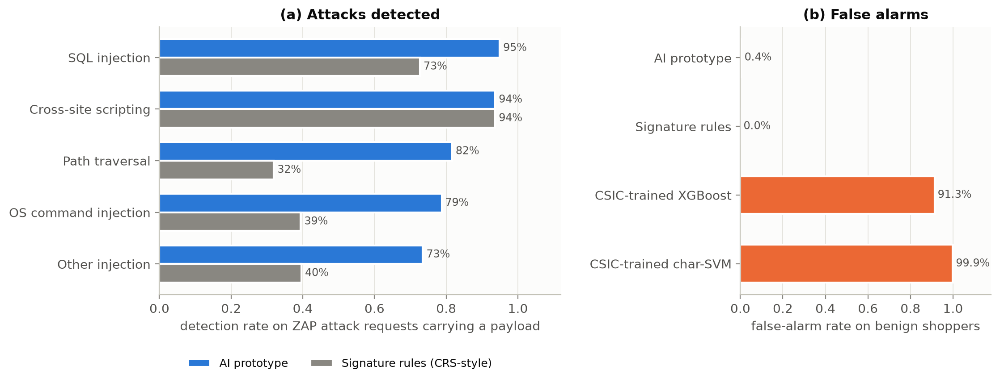

# AI-Assisted Web Application Penetration Testing

**Detecting and classifying web attacks in network flows and HTTP requests with machine learning, compared with conventional detection and validated live against OWASP ZAP.**

> **Research question:** *How effectively can AI/ML assist in detecting and classifying web-application attacks, and how does its performance compare with conventional detection?*
> CSCI 561 Computer and Network Security, Topic 4. The IEEE-format paper is [`paper/main.tex`](paper/main.tex) ([PDF](paper/main.pdf)).

The project works at three levels:

| Level | Data | What the AI does | Conventional comparison |
|---|---|---|---|
| **Network flows** | CIC-IDS2017 (Thursday web attacks + benign Monday) | 6 ML detectors on 66 CICFlowMeter features | statistical threshold IDS (Denning-style) |
| **HTTP requests** | HTTP CSIC 2010, HttpParamsDataset, SR-BH 2020, and a combined dataset | URL/parameter/header/content features, engineered features, a learned app profile, char n-gram NLP model, hybrid | 31 signature rules modelled on the OWASP CRS |
| **Live lab** | OWASP Juice Shop + benign shoppers + OWASP ZAP active scan | prototype that scores each parameter value, names the attack, assigns risk and ranks endpoints | OWASP ZAP findings and the signature rules |

---

## Key results

| Setting | Best AI | Conventional |
|---|---|---|
| CIC-IDS2017 flow detection (5-fold CV F1) | XGBoost **0.998** | threshold IDS **0.000** (ROC-AUC 0.49) |
| … after the validity audit (payload flows, no TCP fingerprint) | XGBoost **0.960**, RF 0.968 | 0.000 |
| CSIC 2010 requests, de-duplicated (held-out F1) | hybrid **0.995**, char-SVM 0.994, XGBoost 0.993 | signatures 0.339 |
| HttpParams attack type (macro-F1, 5 classes) | char-SVM **0.999** | signatures 0.789 |
| Juice Shop lab, payload-bearing ZAP requests (recall SQLi / XSS / traversal / cmd) | **0.95 / 0.94 / 0.82 / 0.79** at 0.45% false alarms | signatures 0.73 / 0.94 / 0.32 / 0.39 at 0% |

**Are the accuracies real?** ([`webreq/sanity.py`](src/webreq/sanity.py))

- **S1, shuffled labels:** the char-SVM falls to ROC-AUC 0.509, which is chance.
- **S2, near-duplicates:** 34.6% of CSIC test requests have a near-duplicate in training. On novel requests only, F1 is still 0.990–0.992.
- **S3, bootstrap 95% CIs:** XGBoost [0.991, 0.995], char-SVM [0.992, 0.996], hybrid [0.993, 0.997]. They overlap, so the three are statistically tied.
- **S4, structure only (no content):** F1 0.84. CSIC is partly "easy".

**The traps we found:**

- **CIC-IDS2017:** 91% of attack flows carry no payload, and 94% share the attacker's TCP window.
- **CSIC 2010:** 64% of requests are exact duplicates.
- **SR-BH 2020:** 76% of the unique "normal" requests are ZAP scan traffic or carry injection payloads.
- **Cross-application failure:** models trained on whole CSIC requests flag 91–99.9% of benign Juice Shop traffic. That is why the prototype scores parameter values with payload-trained models.
- **Combined CSIC + SR-BH dataset** (77,188 unique requests, [`webreq/unified.py`](src/webreq/unified.py)):
  - Pooled (U1): one char-SVM trained on both sources reaches F1 0.993 on each. The learned profile, however, flags 57% of SR-BH's benign requests, because an open website keeps producing unseen endpoints.
  - Cross-source (U2): ML models collapse (ROC-AUC 0.46–0.67), while signature rules transfer (F1 0.75 at 0.06% FPR).
  - Source shortcut (U3): the source is recognisable but carries no label information (ROC-AUC 0.52).

**Comparison with published work** (same protocol as theirs: random split, duplicates kept):

| Dataset | Ours | Published |
|---|---|---|
| CSIC 2010 | 99.88% | 99.77% (Tadhani 2024, CNN-LSTM); 90.9% (Yang 2025) |
| HttpParams | 99.97% | 92.2% (Yang 2025) |

<p align="center">
  <br>
  <br>
  
</p>

---

## Repository layout

```
├── src/
│   ├── download_data.py · preprocess.py · config.py · data.py · metrics.py
│   ├── models.py            flow detectors (LR, linear SVM, RF, HistGB, XGBoost, MLP)
│   ├── baseline.py          conventional threshold IDS
│   ├── train_eval.py        E1 detection, E2 attack type (held-out + 5-fold CV)
│   ├── unseen_attacks.py · evasion_timing.py · cross_day.py · scope_shortcut.py · validity_audit.py   (E3-E7)
│   ├── webreq/              request-level work
│   │   ├── datasets.py      CSIC 2010, HttpParams, SR-BH 2020 download + verification
│   │   ├── httpreq.py       request model: decoding, parameters (query/form/JSON/path), endpoint templates
│   │   ├── features.py      35 base features (URL / parameters / headers / content) + 9 engineered
│   │   ├── engineering.py   learned per-endpoint/parameter profile, correlation filter
│   │   ├── models.py        LR, RF, XGBoost, char n-gram SVM, hybrid (tuned hyperparameters)
│   │   ├── signatures.py    31 CRS-style signature rules (conventional baseline)
│   │   ├── tuning.py        R5: EDA, feature ablation, inner-CV tuning, validation curves
│   │   ├── experiments.py   R1-R4 + trains the prototype bundle
│   │   ├── sanity.py        S1-S4 "are the accuracies real" checks
│   │   ├── unified.py       combined CSIC + SR-BH dataset (U1 pooled, U2 cross-source, U3 shortcut)
│   │   └── analyzer.py      the prototype: per-parameter scoring, attack type, risk, prioritisation
│   ├── lab/                 live lab: setup_tools, run_lab, logging proxy, benign shoppers, compare
│   ├── make_figures.py · run_all.py
├── app/app.py               Streamlit UI (analyse a request, analyse traffic, flow IDS, results)
├── results/                 metrics JSON, CSV tables, figures; webreq/ and lab/ sub-folders
├── paper/main.tex           IEEE conference paper (compile with tectonic or pdflatex)
└── tests/                   pytest: flow-column mapping + request features/analyzer
```

## Quick start

```bash
python -m pip install -r requirements.txt
cd src
python download_data.py                    # CIC-IDS2017 (verified against published counts + SHA-256)
python run_all.py --skip-download          # flow experiments, request experiments R1-R5, figures
python -m webreq.sanity                    # S1-S4
python -m webreq.unified                   # combined dataset (downloads SR-BH 2020, ~400 MB, MD5-checked)
python -m pytest ../tests -q
```

**User interface:** `streamlit run app/app.py` (from the repository root). Paste a raw HTTP request, or upload proxy logs, HAR, CSV, raw requests or an access log; the **demo** button loads ZAP traffic from the lab run. The UI also scores CICFlowMeter CSVs.

**Live lab** (about 1 hour; authorised local use only, everything binds to 127.0.0.1):

```bash
cd src
python -m lab.setup_tools      # once: Juice Shop, Java runtime, OWASP ZAP 2.17
python -m lab.run_lab          # benign shoppers -> ZAP explore + active scan -> comparison
```

Everything is seeded (`RANDOM_STATE = 42`).

## Data

| Dataset | Level | Source | Notes |
|---|---|---|---|
| CIC-IDS2017 | flows | UNB CIC | port-80 flows, 6,052 duplicates removed → 19,725 flows; Monday as unseen benign day |
| HTTP CSIC 2010 | requests | CSIC | 97,065 → **34,593 unique** requests (46% anomalous) |
| HttpParamsDataset | parameter values | GitHub (Morzeux) | 5 classes; test payloads also seen in training are removed |
| SR-BH 2020 | requests | Harvard Dataverse, doi:10.7910/DVN/OGOIXX (CC0) | CAPEC labels; CAPEC-16-only requests removed; mislabelled "normal" requests dropped |

## Method highlights

- **Features**:
  - URL: method, length, depth, unusual characters, backup extensions, traversal.
  - Parameters: count, lengths, %-encoding, double encoding.
  - Headers: content-bearing headers only. Tool and session headers such as User-Agent, Cookie and X-ZAP-Scan-ID are never input.
  - Content: special characters, entropy, SQL/XSS/cmd/traversal/SSI keywords.
- **Engineered features**: special-character runs, function calls, class switches, obfuscation, mixed-case keywords, keyword density, tokens, non-alphanumeric ratio, URLs in values.
- **Learned profile** (Kruegel & Vigna style): per endpoint and parameter, learns normal length, characters and character classes from benign training data. It is decisive on CSIC (XGBoost 0.879 → 0.990) but fails on an open-world site such as SR-BH.
- **Regularisation**: inner 3-fold CV on the training split only.
  - LR: L1/L2/elastic net and C.
  - RF: depth and features per split. The overfitting gap halved.
  - XGBoost: λ, α, minimum child weight, depth, shrinkage, subsampling.
  - SVM: C.
- **Prototype**:
  - A calibrated char-SVM and XGBoost ensemble scores every query, form, JSON, unusual path or header value.
  - Risk = P(attack) × severity, with CWE mapping and explanations (fired signatures, out-of-range features).
  - Endpoints are ranked by max risk × log(1 + requests).

## Limitations

- Brute force and access-control abuse leave no payload in a single request, so they need session-level features.
- CSIC is generated traffic.
- SR-BH needed heavy label cleaning.
- The lab used one application and one scanner.
- Adaptive payload rewriting was not modelled.

## Responsible use

Only public datasets are used. The lab starts an intentionally vulnerable application on the loopback interface and attacks only that instance. Run it only on systems you own or are authorised to test.

## References

The full list with DOIs is in [`paper/references.md`](paper/references.md). The key ones:

- Fasla & Mehmood, *Artificial Intelligence Review* 2026 (systematic review; the paper maps its open issues to our work)
- Wang & D'Cruze, ITNG 2024 (ChatGPT-4-assisted pentesting)
- Khairmode et al., ICOSICS 2026 (AutoRed: Nmap + CVE retrieval + LLM)
- Sharafaldin et al., ICISSP 2018 (CIC-IDS2017)
- Engelen et al., IEEE SPW 2021
- Kruegel & Vigna, ACM CCS 2003
- Tadhani et al., *Sci. Rep.* 2024
- Yang et al., *ESWA* 2025
- Sureda Riera et al., *Computers & Security* 2022 (SR-BH 2020)
- Qu et al., IEEE TIFS 2024
- Floris et al., IEEE TIFS 2025
- Arp et al., USENIX Security 2022
